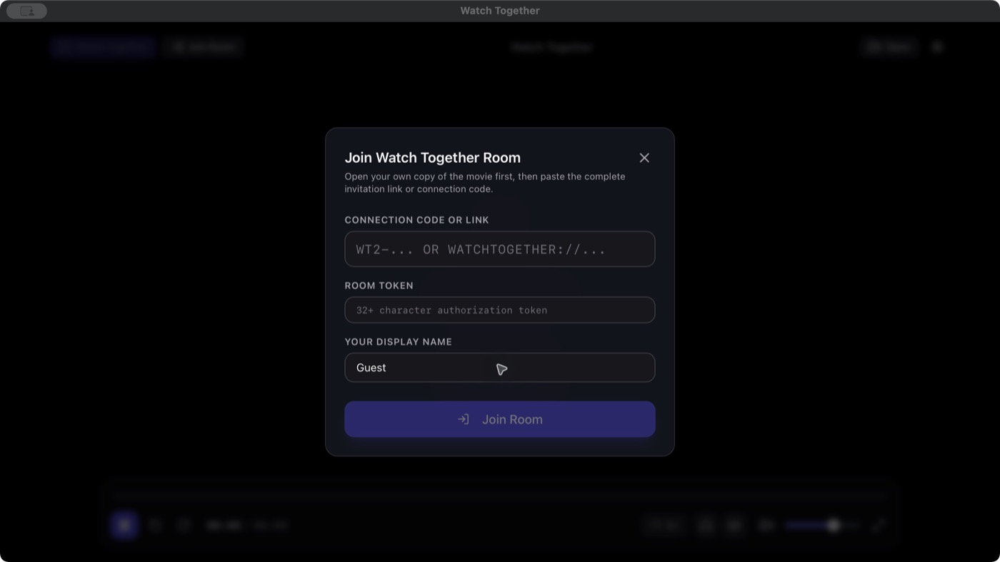

# Watch Together

**Смотрите фильмы вместе, даже когда вы далеко друг от друга.**

Десктопный плеер для macOS и Windows, который синхронизирует просмотр видео с друзьями.

[Скачать для macOS](https://github.com/dmsznv-dot/WatchTogether/releases/download/preview-88615bd/Watch_Together_macOS.dmg) · [Скачать для Windows](https://github.com/dmsznv-dot/WatchTogether/releases/download/preview-88615bd/WatchTogether-Windows-x64-Setup.exe) · [Все версии](https://github.com/dmsznv-dot/WatchTogether/releases)

## Как это работает

У каждого участника есть своя копия одного и того же фильма. Один человек создаёт комнату и отправляет код подключения остальным. Приложение синхронизирует воспроизведение, паузу и перемотку — сам видеофайл по сети не передаётся.

## Возможности

- **Совместный просмотр:** до пяти человек в комнате, с общим управлением или управлением только у ведущего.
- **Личные настройки:** каждый выбирает громкость, аудиодорожку и субтитры; можно добавить внешние файлы.
- **Mac и Windows:** участники могут смотреть вместе с разных платформ.
- **Подключение через интернет:** без ручной настройки роутера и VPN. При необходимости используется relay-сервер.
- **Видео до 1080p / 60 fps**, поддержка HDR на совместимых экранах.

## Начать просмотр

1. Установите одну и ту же версию приложения на каждый компьютер.
2. Откройте одинаковые копии фильма: их длительность должна совпадать с точностью до 1,5 секунды.
3. Ведущий нажимает **Watch Together**, создаёт комнату и отправляет код подключения.
4. Остальные нажимают **Join Room** и вводят код.

## Установка

**macOS 15+, Apple Silicon:** откройте DMG и перенесите приложение в «Программы». Сборка не подписана Apple: при первом запуске может понадобиться открыть «Системные настройки» → «Конфиденциальность и безопасность» → «Всё равно открыть».

**Windows 10 / 11, x64:** запустите установщик. Если появится SmartScreen, выберите «Подробнее» → «Выполнить в любом случае».

Это предварительные сборки. Другие версии и обновления доступны на странице [Releases](https://github.com/dmsznv-dot/WatchTogether/releases).

## Для разработчиков

Приложение построено на Tauri, React, TypeScript и Rust; для воспроизведения используется libmpv, для соединения — iroh.

[Инструкция по сборке и технические детали](docs/DEVELOPER_GUIDE.md) · [Подробнее о синхронизации](docs/SELF_HOSTED_SYNC.md)

Лицензия: MIT или Apache-2.0 на выбор.
